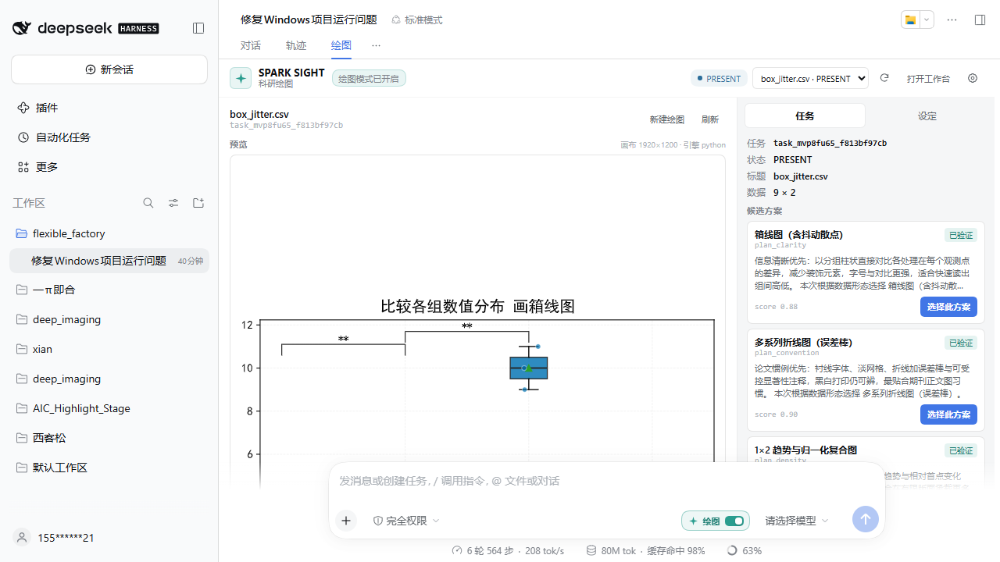

# SPARK SIGHT for DeepSeek Harness

> 灵感视界 SPARK SIGHT — 深度融合进 DeepSeek Harness 的科研绘图插件。

An independent, third-party plugin that brings SPARK SIGHT research-plotting
into [DeepSeek Harness](https://github.com/deepseek-ai/deepseek-harness).
**This is an independent plugin; it is not provided, endorsed, or certified by
DeepSeek.**

## What the native integration adds

- **A switch beside the model selector.** A compact “绘图 / Plots” switch is
  registered in `conversation.input.right`, immediately before
  `conversation.input.model`. Turning it on for the first time opens a native
  login dialog.
- **Native local login.** Username/password, account registration, a one-click
  bootstrap administrator, or a local guest. The signed identity token is kept
  by the Host in the plugin data directory (`0600`); it is never stored in
  `localStorage` and never sent to the browser.
- **A real “绘图 / Plots” Conversation View** next to Trajectory. It renders the
  actual SVG produced by the plotting pipeline, lists candidate plans,
  clarification questions, feedback, export and settings — not an iframe.
- **Model-callable tools.** DSH’s own model turn and polling now drive the
  plotting backend through `sparksight_plot`, `sparksight_status`,
  `sparksight_preview`, `sparksight_select`, `sparksight_answer`,
  `sparksight_feedback`, and `sparksight_export`. A system-prompt section tells
  the model when to use them.
- **The full workbench is still one click away.** The same-origin Stage iframe
  remains available for deep editing and the complete SPARK SIGHT UI.

The switch controls whether the Plot View is active for a Session. The model
tools are always registered; the prompt and the switch make their intended use
explicit.



## Status

Developer milestone **M4 — native DSH integration**. The Host half owns the
local-agent sidecar and all credentials; the Client half registers native DSH
slots and a Conversation View. Login → data → plans → preview → feedback →
export works end to end without a remote server, and the model can drive the
same pipeline through tools.

## Install

The plugin renders in the Harness Web UI, which the official desktop app also
uses. Install into the profile you actually use.

```sh
# Official desktop app
dsh plugin --profile desktop add sparksight-dsh

# Browser Web UI
dsh plugin --profile web add sparksight-dsh
```

During development, use the local path:

```sh
dsh plugin --profile desktop add ./apps/dsh
```

Restart Harness (or quit and reopen the desktop app) after installing. For a
manual development install, link `apps/dsh` into the profile's `node_modules`,
add `"sparksight-dsh"` to `dsh.profile.bundles` and a
`"sparksight-dsh": "link:<absolute path>"` dependency in the profile
`package.json`, then restart. Do **not** add a bare `- id: sparksight-dsh` row to
`cordis.patch.yml`: the plugin package carries its own `insert` patch, and a
duplicate top-level row does not load the bundle.

## Native architecture

### Host half (`index.js`)

- Starts `@deep-imaging/local-agent` as a loopback sidecar with a stable
  `LOCAL_AGENT_AUTH_SECRET` and a persistent data directory, so login survives
  restarts.
- Registers exact same-origin routes through `ctx.connection.fetch`:
  `GET /api/sparksight/bootstrap`, the `/api/sparksight/auth/*` routes,
  `POST /api/sparksight/api` (allow-listed JSON relay),
  `POST /api/sparksight/tasks` (multipart upload),
  `GET /api/sparksight/export` (ZIP download), and the optional Stage routes.
- Registers the seven `sparksight_*` tools with raw JSON Schemas (no
  `@deepseek-ai/dsh-tools` import, no build step) and a prompt section at order
  ~1200.
- Keeps the identity token host-side. The browser only sees a boolean login
  state and a public user shape.

### Client half (`client.js`)

- Registers a real View definition for target `sparksight` with
  `ctx.uiConversation.views.register`, plus a `conversation.view` slot entry at
  order `15` (Trajectory is `10`, Chat is first).
- Registers the model-adjacent switch in `conversation.input.right` at order
  `20`.
- Registers `zh`/`en` dictionaries, theme-token CSS, and the login dialog.
- Polls the selected task through the Host relay; DSH supplies the model turn,
  the browser view only reflects durable task state.
- Uses the real `preview` SVG as a Blob URL. It does not re-render charts in the
  browser.

### Login and local-first defaults

The sidecar runs with `LOCAL_ONLY_MODE=1`, `REMOTE_MODE=0`,
`LOCAL_AGENT_PERSIST=1`, and `LOCAL_AGENT_CLOUD_ACCOUNT_URL=''` by default, so
accounts and data stay local. Set `cloudAccountUrl` explicitly to opt back into
a cloud account service. A random bootstrap administrator is created on first
boot; its credentials live in `admin-bootstrap.local` in the data directory and
are never logged.

## Configuration

| Field | Type | Default | Purpose |
|---|---|---|---|
| `autoStart` | boolean | `true` | Launch the sidecar when the plugin mounts |
| `agentDir` | string | auto | Explicit local-agent directory; otherwise `resources/agent`, then the monorepo dev path |
| `port` | number | `0` (random) | Fixed sidecar port via `LOCAL_AGENT_PORT` |
| `dataDir` | string | `%LOCALAPPDATA%\SPARK-SIGHT\dsh\agent-data` | Persistence directory (`LOCAL_AGENT_DATA_DIR`) |
| `webDir` | string | auto | Web build served same-origin; else `resources/web/dist`, then `apps/web/dist` |
| `adminUsername` | string | `redacted` | Bootstrap admin name via `LOCAL_AGENT_ADMIN_USERNAME` |
| `adminPassword` | string | random | Bootstrap admin password; otherwise generated into `admin-bootstrap.local` |
| `cloudAccountUrl` | string | `''` | Optional cloud account endpoint; empty forces fully local identities |

The agent binds `127.0.0.1` only and generates a random boot token on every
start, which the Host reads from stdout. API calls use
`Authorization: Bearer <token>` and the WebSocket authenticates after the
handshake. The native UI never uses that boot token.

## Layout

```
apps/dsh/
├── package.json          # dsh.bundle.patch + dsh.client manifest
├── cordis.patch.yml      # inserts the plugin row into the profile composition
├── index.js              # Host half: sidecar, auth, relay, tools, prompt
├── client.js             # Client half: toggle, login, Plot View, Stage overlay
├── lib/
│   ├── agent-client.js   # loopback HTTP client + proxy allow-list
│   ├── auth.js           # host-side token persistence + login modes
│   ├── tools.js          # sparksight_* definitions + prompt section
│   ├── sidecar.js        # sidecar process lifecycle
│   ├── paths.js          # persistent data directory
│   └── updater.js        # verified update check/download
├── resources/agent/      # packaged local-agent
├── resources/web/dist/   # packaged SPARK SIGHT web build
└── locale/{zh,en}.json   # plugin-market metadata
```

## Development

No build step: Host and Client are committed as loadable ES modules. Client code
uses `React.createElement` (no JSX) and the Harness module table for React.
React DOM is optional; portals fall back to inline fixed-position rendering.

Run the plugin test suite:

```sh
node --test apps/dsh/*.test.js
```

The manual smoke scripts used during integration live outside the package and
are not required at runtime.
